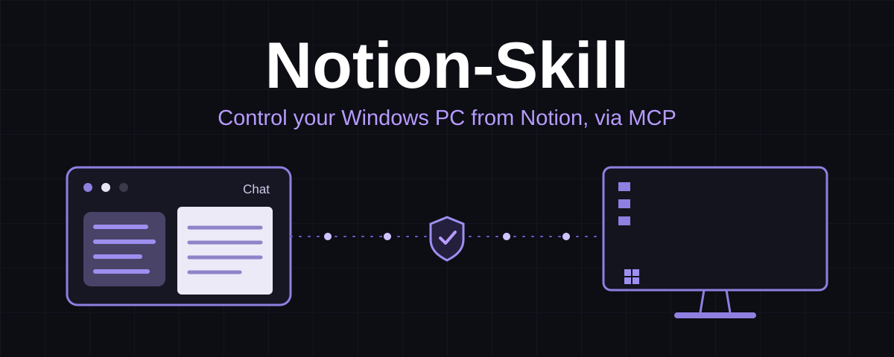
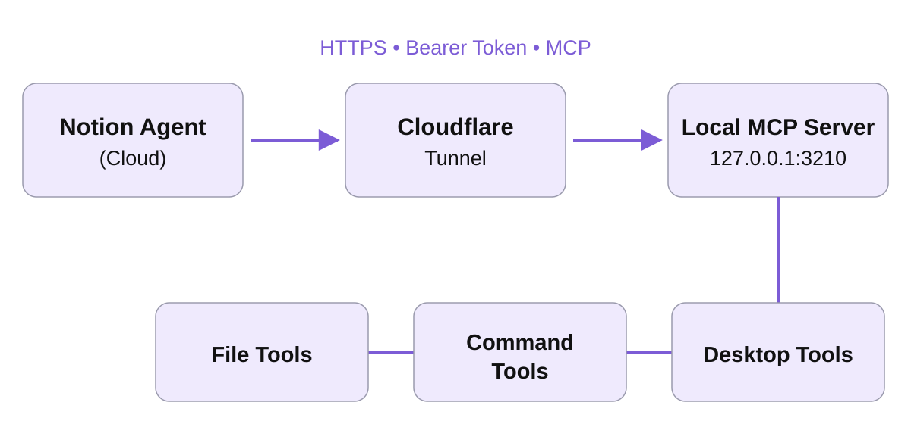
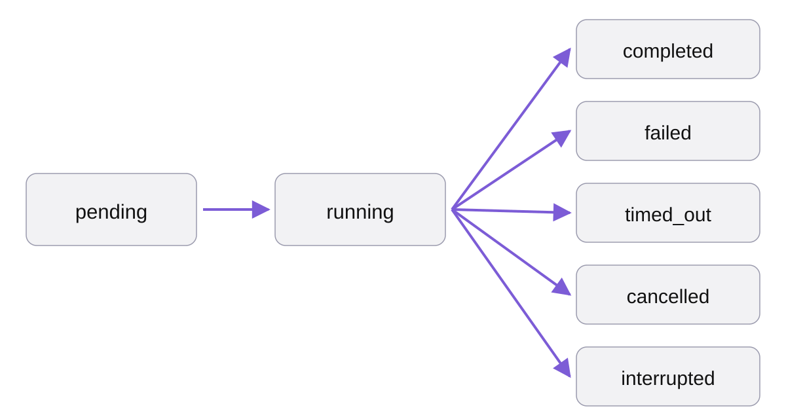

<p align="center">
  
</p>

<h1 align="center">Notion-Skill</h1>

<p align="center">
  <strong>在 Notion 聊天中，用自然语言直接操作你的 Windows 电脑。</strong>
</p>

<p align="center">
  
  
  
  
  
</p>

通过原生 HTTPS MCP 协议，让 Notion Agent 安全地读取、写入、管理本机文件，执行命令，启动程序——所有操作都在你熟悉的 Notion 界面里完成，审批由 Notion 的「为我审核 / Review for me」统一管理。

> **作品定位**：个人独立完成的系统集成与工程实践作品，聚焦 MCP 协议集成、本地服务安全设计、异步任务管理与 Windows 系统编程。

---

## 项目亮点

- **零新增客户端**：不装桌面 App，Notion 本身就是操作界面，本机只做工具执行层。
- **22 个 MCP 工具**：10 个读取工具自动运行，12 个写入工具逐项经过「为我审核」，文件、命令、桌面应用全覆盖。
- **为不可信边界而设计的安全模型**：路径校验针对 Windows 真实攻击面（符号链接、junction、设备路径、备用数据流等）逐一处理；覆盖写保留备份，局部编辑用 `expected_sha256` 做乐观并发控制。
- **完整的异步任务生命周期**：后台长任务独立于单次 HTTP 请求，支持增量日志、断线重连查询、取消与进程树终止，服务重启后状态可核查。
- **一键安装、全程可验证**：`install.ps1` 完成运行时准备（SHA256 校验）、登录授权与服务启动；`npm test` 覆盖路径权限、并发冲突、超时取消、文档解析等边界场景。

---

## 为什么做这个项目

AI 助手正在从「回答问题」走向「执行任务」，但云端助手与本地环境之间始终隔着一道墙。我希望探索一种最小可行、安全可控的桥梁：

- **不引入新的客户端**：用户不需要安装额外的桌面 App，Notion 本身就是操作界面。
- **不牺牲安全性**：文件访问、命令执行、程序启动都经过明确的权限校验与审批流程。
- **不重复造轮子**：基于 MCP（Model Context Protocol）标准协议，复用 Notion 官方托管的 Agent 能力，本机只做工具执行层。

这个项目的技术重心不在于「调用 API」，而在于如何在一个不可信的网络边界两侧，安全、可靠、可观测地完成本机操作。

---

## 技术架构

<p align="center">
  
</p>

核心链路：**Notion Agent → HTTPS 隧道 → 本机 HTTP MCP（127.0.0.1:3210）→ 文件 / 命令 / 桌面工具**。

云端 Agent 通过 Bearer Token 认证的原生 MCP 协议发起调用，经 Cloudflare Tunnel 安全到达只监听本机回环地址的 MCP 服务，再由三类工具执行层完成实际操作。凭据通过 Windows DPAPI 加密存储，与 Notion OAuth 登录流程解耦。

---

## 核心技术工作

### 1. MCP 协议集成与隧道架构

- 将本机能力封装为符合 MCP 规范的工具集（共 22 个工具：10 个读取工具 + 12 个写入工具），Notion 可直接发现并调用。
- 使用 Cloudflare Tunnel 将本机 127.0.0.1:3210 安全暴露为公网 HTTPS 入口，避免直接开放端口。
- 实现 Bearer Token 认证，凭据通过 Windows DPAPI 加密存储，与 Notion OAuth 登录流程解耦。
- 设计临时隧道 + 固定域名隧道两种部署模式，兼顾快速试用与长期稳定运行。

### 2. 安全与权限设计

- 路径校验覆盖 `..`、根目录前缀混淆、符号链接、Windows junction、设备路径、备用数据流——针对 Windows 文件系统的真实攻击面逐一处理。
- 审批模型明确区分「读取工具自动运行」与「写入工具为我审核」，并在文档中坦诚说明 host 模式下服务端无法验证人工点击的安全边界局限。
- 写入一致性：覆盖写保留同目录备份、新建先写临时文件再发布、`edit_file` 使用 `expected_sha256` 防止审批期间文件被篡改（乐观并发控制）。
- 命令资源管控：超时（1 秒–10 分钟）、并发上限（4 个）、记录上限（1000 条）、进程树终止、增量日志流式读取。

### 3. 异步任务生命周期管理

- `start_command` 启动后台长任务，立即返回 `task_id`，运行独立于单次 HTTP 请求。
- 支持断线重连后按原编号查询、运行中增量日志读取（`read_command_log`，按字节偏移）。
- 服务重启后，原 running 任务标记为 interrupted，结果持久化在受保护的 `.runtime/tasks` 中，可供事后核查。
- 任务状态机：

<p align="center">
  
</p>

### 4. 文件系统与文档解析

- 原子写入：临时文件 + 发布，避免部分写入。
- 目录复制：递归复制上限 10000 项 / 2 GiB，失败清理临时目录，拒绝符号链接。
- 跨磁盘移动：普通文件支持跨盘移动，同盘目录使用重命名；跨盘目录移动明确返回 `CROSS_DEVICE_DIRECTORY`。
- 文档解析：`read_document` 支持 PDF、DOCX、XLSX、PPTX 正文提取，在带内存与 30 秒时间限制的独立工作线程中执行，分页返回，截断可报告。

### 5. 工程化与可验证性

- 测试覆盖：`npm test` 覆盖路径权限、全电脑访问、覆盖备份、并发新建冲突、移动重命名、目录复制链接保护、局部编辑冲突、PDF/Office 解析、任务恢复、实时日志、HTTP MCP、PowerShell/CMD 中文输出、超时终止、取消、桌面工具、安装器互斥与凭据加密。
- 一键安装：`install.ps1` 完成 Node.js 运行时准备（含 SHA256 校验）、依赖安装、配置生成、Notion 登录授权、Skill 安装、后台服务启动。
- 日志与状态：`native.ps1 -Action Status/Stop` 提供进程、phase、当前 URL 查询；日志分 `native.log` 与 `native-error.log`。

---

## 工具一览

### 读取工具（自动运行）

| 工具 | 关键行为 |
| --- | --- |
| `list_roots` | 返回访问模式、磁盘、相对路径基准、系统目录 |
| `list_directory` | 分页列出目录（`next_offset` 驱动） |
| `get_path_info` | 真实路径、类型、大小、时间 |
| `search_files` | 按文件名递归搜索，可控深度与数量 |
| `read_file` | 分块读取，支持 utf8 / utf16le / base64 |
| `read_document` | PDF / DOCX / XLSX / PPTX 正文提取 |
| `list_apps` | 已配置应用及运行状态 |
| `get_command_task` | 查询后台任务状态与结果 |
| `list_command_tasks` | 分页找回历史任务 |
| `read_command_log` | 增量读取运行中任务的 stdout/stderr |

### 写入工具（为我审核）

| 工具 | 关键行为 |
| --- | --- |
| `write_file` | 新建默认拒绝覆盖，覆盖保留备份 |
| `edit_file` | 精确替换，唯一匹配，`expected_sha256` 防冲突 |
| `create_directory` | 逐级创建，父目录必须存在 |
| `copy_file` / `copy_directory` | 拒绝覆盖，递归上限保护 |
| `move_path` / `rename_path` | 拒绝覆盖，跨盘目录明确报错 |
| `run_command` | 同步短命令，返回输出与退出码 |
| `start_command` | 后台长任务，立即返回 `task_id` |
| `cancel_command_task` | 终止命令进程树 |
| `ensure_app` | 按需启动配置中的应用 |
| `open_path` | 打开文件/目录或资源管理器定位 |

---

## 快速开始

### 安装（Windows）

```powershell
# 克隆仓库后，在项目目录运行
powershell -NoProfile -ExecutionPolicy Bypass -File .\install.ps1
```

安装器会准备 Node.js、下载 cloudflared 并校验、创建配置、引导 Notion 登录、安装 Skill，并在当前会话后台启动 MCP 与隧道。

### 连接 Notion

1. Notion 设置 → 连接 → 浏览连接 → 添加连接 → 自定义 MCP 连接。
2. URL 填 `.runtime/native-connection.json` 中的 url，名称填 Notion-skill。
3. 验证选 Bearer token，Token 填 headers.Authorization 去掉 `Bearer ` 后的部分。
4. 读取工具设为「自动运行」，写入工具设为「为我审核」。
5. 新建聊天，选择 Notion-skill，审批模式设为「为我审核」。

### 服务管理

```powershell
# 启动（复用已运行的服务）
powershell -NoProfile -ExecutionPolicy Bypass -File .\native.ps1 -Action Start

# 查看状态（进程、phase、当前 URL）
powershell -NoProfile -ExecutionPolicy Bypass -File .\native.ps1 -Action Status

# 停止（取消命令任务，关闭 MCP 与隧道）
powershell -NoProfile -ExecutionPolicy Bypass -File .\native.ps1 -Action Stop
```

---

## 使用示例

- “列出这台电脑的磁盘，读取桌面的报告并总结。”
- “新建一个文本文件，写入下面的内容。”
- “把 D:\资料\报告.pdf 复制到 E:\备份。”
- “clone 仓库到 E:\Projects，并告诉我结果。”
- “运行项目测试，超时设为五分钟。”
- “在资源管理器中定位 README.md，用记事本打开。”

---

## 技术栈

| 层面 | 技术 |
| --- | --- |
| 协议 | MCP（Model Context Protocol），原生 HTTPS MCP |
| 运行时 | Node.js 22.16+（支持便携运行时，SHA256 校验） |
| 隧道 | Cloudflare Tunnel（cloudflared，临时 + 命名隧道） |
| 认证 | OAuth + PKCE + 动态客户端注册（安装/更新 Skill），Bearer Token（日常工具调用） |
| 凭据存储 | Windows DPAPI 加密 |
| 文件系统 | Node.js fs + 自定义路径校验（符号链接、junction、ADS） |
| 文档解析 | PDF / DOCX / XLSX / PPTX 解析，独立工作线程 + 资源限制 |
| 命令执行 | PowerShell / CMD，进程树管理，增量日志流式读取 |
| 测试 | Node.js 测试运行器，覆盖边界条件与并发场景 |

---

## 设计取舍与已知边界

- **单机单用户定位**：当前设计面向一台 Windows 电脑、一个 Windows 账户，不涉及多租户或分布式协调。复杂度集中在单机可靠性而非水平扩展。
- **隧道依赖**：临时隧道每次启动 URL 变化，需在 Notion 更新连接；固定域名隧道（publicUrl + 命名隧道）可解决，但需自备域名与进程托管。
- **审批边界**：host 模式将审批交由已认证客户端，服务端无法验证某次调用是否经过人工点击——这是 HTTPS MCP 架构的固有局限，文档中已明确说明。
- **文档解析范围**：PDF 仅使用文字层，扫描件需 OCR；图片、图表、复杂排版可能无法完整提取，warnings 会说明范围。
- **命令副作用**：超时、取消或失败可能留下部分修改；重启后原 running 任务标记为 interrupted，需核查实际状态后决定是否重试。

---

## 测试与验证

```bash
npm test       # 单元与集成测试，覆盖边界条件、并发冲突、超时取消、格式解析
npm run verify # 真实登录创建私有验证任务，端到端确认（旧版轮询模式）
```

测试覆盖：文件路径权限、全电脑访问、已有目录授权兼容、覆盖备份、并发新建冲突、移动重命名、目录复制链接保护、局部编辑冲突、PDF/Office 解析、任务恢复、实时日志、HTTP MCP、PowerShell/CMD 中文输出、超时终止、取消、桌面工具、安装器互斥、凭据加密。

---

## 目录结构

```
├── src/                    # MCP 服务、工具实现、任务管理
├── skills/                 # Notion Skill 模板（notion-local-files）
├── test/                   # 测试用例
├── docs/images/            # README 配图
├── install.ps1             # 一键安装脚本
├── native.ps1              # 服务启动/状态/停止
├── package.json
└── .runtime/               # 运行时配置、凭据、任务记录（Git 忽略）
```

---

## 关于

独立项目，用于探索 AI Agent 与本地环境的安全交互边界。技术重点在 MCP 协议集成、本地服务安全设计、异步任务生命周期管理与 Windows 系统编程。

## License

[MIT](LICENSE)
